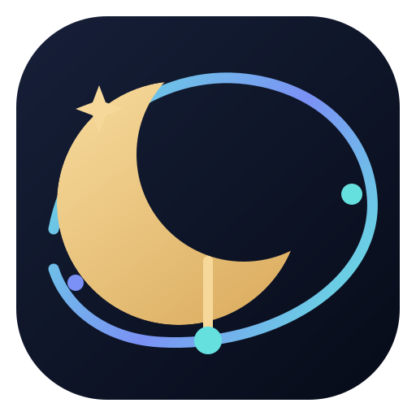

  

<h1 align="center">MOONWITNESS IDE</h1>
<h3 align="center">The Engineering Observatory</h3>

<strong>Understand the system. Trace the evidence. Build with intention.</strong>

MOONWITNESS IDE is an open-source development environment being shaped around a simple belief: software engineering should produce more than working code. It should also produce understanding, traceable decisions, verifiable results, and knowledge that survives beyond a single developer or session.

The project aims to evolve a fast, native code editor into an **evidence-driven engineering workspace**—a place where developers can explore a repository, understand its architecture, make changes deliberately, verify outcomes, and preserve the reasoning behind their work.

> **The Moon Watches. The Record Remembers. The Evidence Remains Inspectable.**

**Brand system:** [BRAND.md](BRAND.md) · **Product blueprint:** [BLUEPRINT.md](BLUEPRINT.md) · **Build guide:** [docs/building-from-source.md](docs/building-from-source.md) · **Security policy:** [SECURITY.md](SECURITY.md)

## What MOONWITNESS IDE is

MOONWITNESS IDE is the developer-facing engineering environment in the wider MOONWITNESS XV vision. It is intended to connect five parts of disciplined software work:

1. **Workspace** — a responsive environment for editing, navigating, and operating on code.
2. **Understanding** — tools that help developers build a reliable mental model of a repository and its architecture.
3. **Evidence** — visible links between changes, tests, diagnostics, decisions, and the source material that supports them.
4. **Continuity** — durable project knowledge so important context does not disappear between contributors or work sessions.
5. **Human direction** — automation and AI that assist within explicit boundaries, while people retain authority and responsibility.

This is an evolving product direction, not a claim that every capability described here is already implemented.

## Why an Engineering Observatory?

Modern code editors are excellent at helping developers type and navigate code. Complex projects need more: a way to see how components relate, understand why decisions were made, distinguish verified behavior from assumptions, and carry context forward.

MOONWITNESS IDE uses the observatory metaphor deliberately:

- **Observe before changing.** Inspect the repository and its behavior before proposing modifications.
- **Trace before trusting.** Connect claims to source files, tests, logs, or other inspectable evidence.
- **Verify before declaring.** A proposed change is not a verified result.
- **Preserve what matters.** Keep useful decisions, constraints, and project knowledge accessible.
- **Keep humans responsible.** AI may assist; it does not become the authority.

The goal is not to replace developer judgment. It is to give that judgment a clearer workspace.

## Current technical foundation

MOONWITNESS IDE is currently based on the open-source [Lapce](https://github.com/lapce/lapce) codebase. The upstream foundation provides a native Rust application and an existing editor architecture.

The inherited capabilities documented by the upstream project include:

- Rust application foundation and a UI built with [Floem](https://github.com/lapce/floem).
- GPU-accelerated rendering through [wgpu](https://github.com/gfx-rs/wgpu).
- Rope-based text editing technology.
- Language Server Protocol (LSP) integration for completion, diagnostics, and code actions.
- Modal, Vim-like editing.
- Integrated terminal.
- Remote development support.
- WASI-oriented plugin support.

These are capabilities of the inherited Lapce foundation. Their exact status, compatibility, and presentation in this fork must be validated against the current branch and build. See the upstream [Lapce project](https://github.com/lapce/lapce) for its original documentation.

## Product principles

### Evidence over assumption
Every important engineering claim should be traceable to something inspectable: code, a test result, a diagnostic, a log, a specification, or an explicitly identified source.

### Understanding before automation
Automation should operate with repository context and clearly stated constraints. It should not conceal uncertainty or silently make high-impact decisions.

### Human authority by design
Developers decide what to accept, modify, execute, publish, and release. AI-generated suggestions remain proposals until reviewed and accepted.

### Preserve the original
Keep source material, project history, and the distinction between original content and derived interpretation. Do not rewrite project history to make a narrative look cleaner.

### Clarity over spectacle
Prefer understandable workflows, inspectable state, and useful feedback over impressive but opaque automation.

### Incremental trust
Trust is earned through reproducible behavior, tests, review, and transparent limitations—not through branding or claims.

## Relationship to MOONWITNESS XV

MOONWITNESS IDE belongs to the broader MOONWITNESS XV ecosystem, but it has a specific responsibility: **the engineering workspace**.

| Project / layer | Intended responsibility |
|---|---|
| MOONWITNESS XV | The overarching ecosystem and shared vision |
| MOONWITNESS IDE | Developer workspace for building, inspecting, and verifying software |
| ARSY | The ecosystem's central backend hub, according to the wider architecture |
| LUMEN | A planned AI framework / worker capability operating through defined contracts |
| HEADQUARTERS / 100CENTER | Human governance, coordination, and oversight |
| ORBIT | A planned spatial or immersive interface |

These boundaries matter. MOONWITNESS IDE is not a replacement for ARSY, a governance authority, or an autonomous source of truth. Any future integration should use explicit interfaces and documented contracts. Planned ecosystem components must not be presented as active integrations until implemented and verified.

## Product direction

The following capabilities describe the intended evolution of the IDE. They are **roadmap directions**, not assertions that they are currently available.

### Repository intelligence
Help developers map project structure, identify important modules, follow dependencies, and navigate relationships across a codebase.

### Architecture awareness
Make architectural boundaries, interfaces, decisions, and constraints easier to inspect and maintain.

### Evidence-linked development
Connect proposed changes to relevant files, tests, diagnostics, design notes, and verification results.

### AI-assisted engineering
Offer context-aware explanations, implementation proposals, test suggestions, and review assistance. Keep generated output reviewable and under developer control.

### Project memory and continuity
Preserve approved project knowledge—such as decisions, constraints, and operational notes—with provenance and clear ownership.

### Responsible automation
Support explicit, bounded actions with visible scope, meaningful confirmation points, and inspectable outcomes.

## A disciplined engineering workflow

1. **Observe** — inspect the workspace and identify the task.
2. **Understand** — gather relevant code, architecture, history, and constraints.
3. **Design** — state the intended change and its expected impact.
4. **Build** — implement the smallest coherent change.
5. **Test** — run relevant automated and manual checks.
6. **Verify** — inspect the actual results and record what they prove.
7. **Preserve** — document decisions and durable knowledge.
8. **Improve** — use findings to refine the system.

A successful build is not automatically a successful test. A passing test is not proof of deployment. A deployment is not automatically an accepted release.

## Verification language

MOONWITNESS IDE adopts explicit evidence states to prevent overclaiming:

| State | Meaning |
|---|---|
| **CI_VERIFIED** | Relevant CI checks passed for the identified revision |
| **BUILD_VERIFIED** | A build completed successfully for the identified revision and environment |
| **DEPLOYMENT_READY** | Required deployment prerequisites were checked; deployment has not necessarily happened |
| **DEPLOYED_VERIFIED** | The deployed instance was inspected and verified against the identified revision |
| **RELEASE_ACCEPTED** | The release passed its defined acceptance process |

These states are not interchangeable. Every status should identify its revision, scope, environment, and supporting evidence where applicable.

## Roadmap

The roadmap is intentionally incremental. Priorities may change as implementation and validation reveal what is most valuable.

- **Foundation** — establish project identity, document the upstream relationship, keep the editor buildable, and maintain clear contribution and licensing practices.
- **Product coherence** — align application naming, interface language, settings, documentation, and release identity without destabilizing the inherited editor.
- **Repository understanding** — prototype useful repository maps and architecture navigation, then validate accuracy and performance.
- **Evidence workflows** — connect changes to tests, diagnostics, and reviewable verification records.
- **AI assistance** — introduce bounded, opt-in assistance with transparent context, permissions, and human approval.
- **Knowledge continuity** — design durable, provenance-aware project notes and decision records.
- **MOONWITNESS XV integration** — integrate only through documented, versioned contracts after the relevant services and interfaces are ready.
- **Hardening and release** — security review, performance work, platform validation, reproducible builds, and release acceptance.

## Build and verification

The GitHub Actions workflow is configured to check formatting and spelling, run Clippy, build on Linux, macOS, and Windows, and run workspace documentation tests. These are automated checks, not a blanket release certification. The result for a particular revision is shown by the CI badge above and must be inspected before describing that revision as verified.

See [Building from source](docs/building-from-source.md) for local setup and commands. Report the exact commit, platform, commands, and outcomes when sharing verification results.

## Project status and transparency

MOONWITNESS IDE is an evolving fork. Its product identity is now reflected in the documentation, application-facing labels, brand artwork, default color themes, and platform package display metadata. Some compatibility identifiers—including internal crate and binary names, bundle paths, and desktop IDs—retain Lapce naming. This branding work does not imply that a new AI system, MOONWITNESS XV service integration, or every roadmap capability has shipped.

When reporting progress, identify the exact commit or revision, what changed, which checks were run, the environment and results, and what remains unverified.

Do not describe a feature as implemented, integrated, deployed, or release-ready without evidence for that specific claim.

## Contributing

Contributions should improve the editor while preserving clarity about upstream origins, licensing, and the state of implementation.

Before proposing a substantial change:
1. Explain the problem and intended user benefit.
2. Identify affected components and architectural boundaries.
3. Describe risks and compatibility considerations.
4. Include tests or a verification plan.
5. Document new assumptions or long-term decisions.

Please review the repository's existing contribution guidance and license before contributing. MOONWITNESS IDE is based on Lapce; retain required upstream notices and comply with applicable license terms.

## The mission

Build an engineering environment where developers can move quickly without losing the ability to understand what they are doing, why they are doing it, and how they know it works.

**Observe clearly. Trace honestly. Build deliberately. Verify openly. Preserve knowledge.**

---

*MOONWITNESS IDE — The Engineering Observatory.*
